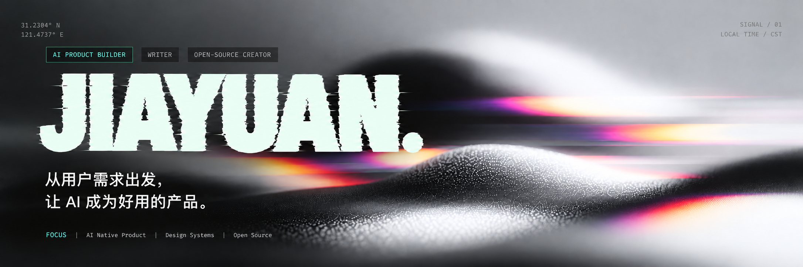

  

---

## 公众号作品

微信公众号「曲总今天闭环了吗」

| 作品 | 阅读 |
| :--- | :--- |
| 作品 01 | [阅读原文](https://mp.weixin.qq.com/s/CynQaTBAO-gGZN8ZnDOs_Q) |
| 作品 02 | [阅读原文](https://mp.weixin.qq.com/s/rce7KgUNI1btTPwUCEi0hw) |
| 作品 03 | [阅读原文](https://mp.weixin.qq.com/s/lhvtD0YBwoayd9L_2EYkGw) |
| 作品 04 | [阅读原文](https://mp.weixin.qq.com/s/she-SS-qZJTI9EyoqtGNcw) |
| 作品 05 | [阅读原文](https://mp.weixin.qq.com/s/zNBQO_cg8q0kE5Rr3uIx_Q) |
| 作品 06 | [阅读原文](https://mp.weixin.qq.com/s/xcoAG95xCLCkZjn7GhKS_w) |

[查看公众号文章合集 →](https://github.com/quj7897-tech/wechat-articles)

---

<h3 align="center">保持联系</h3>

  <table align="center">
    <tr>
      <td align="center" width="280">
         
        <strong>小红书</strong> 
        不一样设计
      </td>
      <td align="center" width="280">
         
        <strong>微信公众号</strong> 
        曲总今天闭环了吗
      </td>
    </tr>
  </table>
  
扫码关注，保持交流

