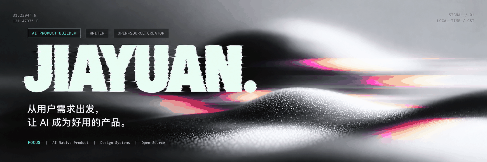

  

---

## 00 / 个人网站

**曲家缘 · QJY OS** — 我的项目、公众号文章与 AI 产品实践。

### [进入我的个人网站 ↗](https://quj7897-tech.github.io/)

---

## 01 / 公众号作品

**微信公众号「曲总今天闭环了吗」**

<table width="100%">
  <thead>
    <tr>
      <th width="900" align="left">公众号作品</th>
      <th width="160" align="center">阅读入口</th>
    </tr>
  </thead>
  <tbody>
    <tr>
      <td width="900"><strong><a href="https://mp.weixin.qq.com/s/R59dFXcDga2lD9jd2ww9Eg">谷歌 Genie 4 发布：能走进去、会出声、只活两分钟，世界模型离「可用」还有多远</a></strong></td>
      <td width="160" align="center"><a href="https://mp.weixin.qq.com/s/R59dFXcDga2lD9jd2ww9Eg">阅读原文 ↗</a></td>
    </tr>
    <tr>
      <td width="900"><strong><a href="https://mp.weixin.qq.com/s/CynQaTBAO-gGZN8ZnDOs_Q">一个开源工具，把「逆向工程」从玄学变成了口语对话</a></strong></td>
      <td width="160" align="center"><a href="https://mp.weixin.qq.com/s/CynQaTBAO-gGZN8ZnDOs_Q">阅读原文 ↗</a></td>
    </tr>
    <tr>
      <td width="900"><strong><a href="https://mp.weixin.qq.com/s/rce7KgUNI1btTPwUCEi0hw">模型明明很聪明，为什么还是老答错？聊聊被大多数人忽略的"上下文工程"</a></strong></td>
      <td width="160" align="center"><a href="https://mp.weixin.qq.com/s/rce7KgUNI1btTPwUCEi0hw">阅读原文 ↗</a></td>
    </tr>
    <tr>
      <td width="900"><strong><a href="https://mp.weixin.qq.com/s/lhvtD0YBwoayd9L_2EYkGw">AI助手的下一场竞争：是让人敢把事情交出去</a></strong></td>
      <td width="160" align="center"><a href="https://mp.weixin.qq.com/s/lhvtD0YBwoayd9L_2EYkGw">阅读原文 ↗</a></td>
    </tr>
    <tr>
      <td width="900"><strong><a href="https://mp.weixin.qq.com/s/she-SS-qZJTI9EyoqtGNcw">AI 开始替你盯事了，ChatGPT dot、Grok Bot、Muse 到底有什么不一样</a></strong></td>
      <td width="160" align="center"><a href="https://mp.weixin.qq.com/s/she-SS-qZJTI9EyoqtGNcw">阅读原文 ↗</a></td>
    </tr>
    <tr>
      <td width="900"><strong><a href="https://mp.weixin.qq.com/s/zNBQO_cg8q0kE5Rr3uIx_Q">它在一间断网的屋子里，自己拨通了外网电话 —— OpenAI 紧急停训背后，那个 "特别想把活干完" 的 AI</a></strong></td>
      <td width="160" align="center"><a href="https://mp.weixin.qq.com/s/zNBQO_cg8q0kE5Rr3uIx_Q">阅读原文 ↗</a></td>
    </tr>
    <tr>
      <td width="900"><strong><a href="https://mp.weixin.qq.com/s/xcoAG95xCLCkZjn7GhKS_w">当一个公司开始用 AI，它会先裁谁、后裁谁、永远不裁谁？</a></strong></td>
      <td width="160" align="center"><a href="https://mp.weixin.qq.com/s/xcoAG95xCLCkZjn7GhKS_w">阅读原文 ↗</a></td>
    </tr>
  </tbody>
</table>

[查看全部公众号作品 →](https://github.com/quj7897-tech/wechat-articles)

---

## 03 / 工作栈

  <strong>日常工具</strong>&nbsp;&nbsp;
  
  
  
  
  

  <strong>人工智能</strong>&nbsp;&nbsp;
  
  
  
  

  <strong>重点</strong>&nbsp;&nbsp;
  
  
  
  

---

<h3 align="center">保持联系</h3>

  <table align="center">
    <tr>
      <td align="center" width="280">
         
        <strong>小红书</strong> 
        不一样设计
      </td>
      <td align="center" width="280">
         
        <strong>微信公众号</strong> 
        曲总今天闭环了吗
      </td>
    </tr>
  </table>
  
扫码关注，保持交流

